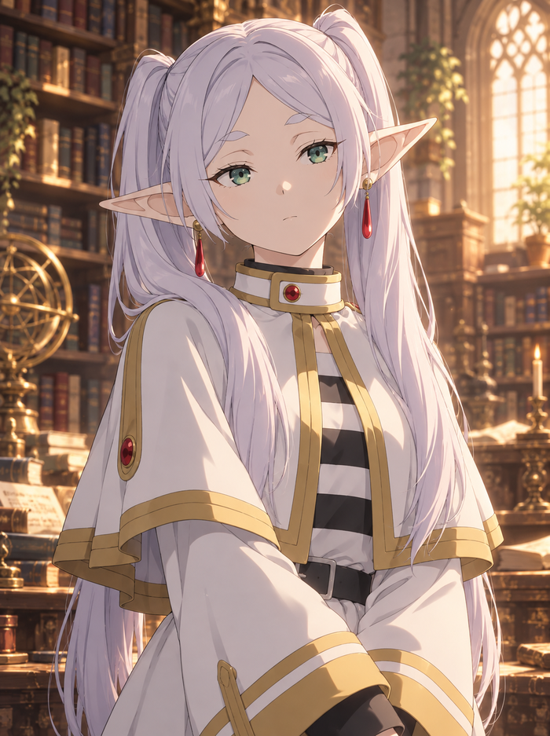

<p align="center">
  
</p>

<p align="center">
  <a href="#deutsch"><strong>🇩🇪 Deutsch</strong></a> •
  <a href="#english"><strong>🇬🇧 English</strong></a> •
  <a href="#русский"><strong>🇷🇺 Русский</strong></a>
</p>

<p align="center">
  <strong>Das offizielle Inhalts-Repository für <a href="https://github.com/SnowwhiteOakheart/OtakuSoul">OtakuSoul</a></strong><br>
  <em>Modulare Charakterkarten · Emotions-Ausdrücke · Soul Stages · Welten-Lorebooks · Szenen-Hintergründe</em>
</p>

<p align="center">
  
  
  
  
  
  
</p>

<p align="center">
  <a href="cards_gateway/Miku_Nakano.png"></a>
  <a href="cards_gateway/Frieren.png"></a>
  <a href="cards_gateway/chisato_nishikigi.png"></a>
  <a href="cards_gateway/rem.png"></a>
  <a href="cards_gateway/yor_forger.png"></a>
  <a href="cards_gateway/okabe_rintarou.png"></a>
</p>

<p align="center">
  <a href="presets/quintessential-quintuplets/backgrounds/penthouse_wohnzimmer.png"></a>
  <a href="presets/steins-gate/backgrounds/steins_gate_ep1_erste_dmail.png"></a>
  <a href="presets/quintessential-quintuplets/backgrounds/sommerfest_schreintreppe.png"></a>
</p>

---

## Deutsch

### 🌸 Was ist `otakusoul-data`?

Dieses Repository ist die offizielle Datenablage für [OtakuSoul](https://github.com/SnowwhiteOakheart/OtakuSoul). Es versorgt die Anwendung über den integrierten **Hub & Gateway** mit fertigen Inhalten:
- 👥 **Charakterkarten (Tavern / OtakuSoul Character Card V2):** Vollständige V2-Karten im JSON- und PNG-Format (`chara`-Textchunk); 60 Figuren verfügen über das vollständige Set aller 15 aktuellen Bildslots als abgestimmte SFW-Varianten (sechs Basis- und neun Zusatzemotionen); die aus der App übernommene Emilia (Re:Zero) hat vorerst den Sechser-Basissatz.
- 🎭 **Soul Stages (Szenarien & Episoden):** Interaktive Geschichten mit Zielvorgaben, Spielleiter-Tonalität (GM), Rundensteuerung, Startorten und optionalem **5e-Regelwerk**.
- 📖 **Welten-Lorebooks:** Schlüsselwort- und Spannungs-gesteuerte Wissensdatenbanken für dynamische KI-Kontextinjektion.
- 🎨 **Szenenhintergründe & Avatare:** Stimmige 16:9-Umgebungsbilder und optionale VRM-Modellhinweise.
- 🌐 **Oberflächensprachen der App:** `locales/ui/` liefert Übersetzungen von Menüs, Knöpfen und Meldungen; neue Sprachen erscheinen in OtakuSoul ohne App-Update.
- 🌍 **Vollständige Dreisprachigkeit:** Alle nutzerseitigen Texte, Begrüßungen, Dialogbeispiele und Szenen werden in **Deutsch (DE)**, **Englisch (EN)** und **Russisch (RU)** gepflegt.

> 💡 **Schnellübersicht gesucht?**
> - Eine vollständige, tokensparende Übersicht aller 61 Figuren, 52 Stages und 24 Lorebooks bietet [**CONTENT_INDEX.md**](CONTENT_INDEX.md).
> - Den aktuellen Entwicklungsstand und geplante Kampagnen findest du in [**ROADMAP.md**](ROADMAP.md).
> - Technische Standards, Formate und Veröffentlichungsregeln stehen verbindlich in [**AI.md**](AI.md).

---

### 🤝 Mitmachen & Eigene Inhalte beisteuern (Community Contributions)

**Wir freuen uns sehr über Community-Beiträge!** Jeder kann eigene Charaktere, interaktive Geschichten (Soul Stages) oder Lorebooks beisteuern und per Pull Request einreichen.

Damit die Inhalte für alle Nutzer sicher, hochwertig und legal bleiben, beachte bitte die folgenden Grundregeln:

#### ⚖️ Rechtliche Spielregeln (Legal & Safety Guidelines)
1. **Reine Fanart & Originalcharaktere:** Das Repository ist ein nicht-kommerzielles Fanprojekt. Verwende keine offiziellen Artworks, Screenshots oder Scans der Originalstudios als Bildeingabe.
2. **KI-Transparenz & Bildrechte:** Verwende für Porträts und Emotionen eigene KI-Generierungen oder selbst gezeichnete Bilder. Dokumentiere verwendete Prompts und Parameter in `image_prompts.json` (siehe bestehende Pakete).
3. **Strikt jugendfrei (SFW & Safe):** Keine pornografischen, gewaltverherrlichenden oder jugendgefährdenden Inhalte. Charaktere müssen stets altersgerecht dargestellt werden; Minderjährige dürfen keinesfalls sexualisiert werden.
4. **Respektierung von Rechten Dritter:** Keine geschützten Modellgewichte oder gated Modelle einbinden. `recommended_models.json` nimmt nur Modelle auf, die sich ohne Login laden lassen; Modelle ohne freie Lizenz (MIT, Apache-2.0, BSD) brauchen einen Lizenzhinweis und werden in der App gekennzeichnet.

#### 🛠️ Wie reiche ich neue Inhalte ein? (Schritt-für-Schritt)
1. **Forken:** Forke das Repository auf GitHub und klone deinen Fork lokal.
2. **Preset-Ordner anlegen:** Erstelle unter `presets/<dein-paket>/` einen neuen Ordner (`kebab-case`).
3. **Charaktere erstellen:** Lege Character Card V2 JSON- und PNG-Dateien an (mit Pflichtfeldern, mind. 2 Begrüßungen, 3 Beispieldialogen und DE/EN/RU-Übersetzungen laut [AI.md](AI.md)).
4. **Bilder bereitstellen:** Hauptporträt als 700×937 PNG, Expressions als 640×800 WebP unter `presets/<dein-paket>/expressions/<figur>/` – mindestens die sechs Basisstimmungen, für neue vollständige Serien alle 15 Bildslots (die vier Romance-Schlüssel nur als nichtsexuelle Varianten, siehe [AI.md](AI.md)).
5. **Validieren:** Führe den integrierten Validator aus:
   ```sh
   python3 tools/validate_content.py --sync-registry
   ```
   Er gleicht Beschreibungen automatisch in die Registries ab und stellt sicher, dass keine Fehler vorliegen.
6. **Pull Request:** Reiche deine Änderungen als sauberen Pull Request ein!

#### 🌐 Eine neue Sprache für die App beisteuern
1. `locales/ui/en.json` kopieren und als `locales/ui/<kürzel>.json` speichern (z. B. `pl.json`, `pt-BR.json`).
2. Texte übersetzen, Platzhalter wie `{{name}}` unverändert lassen und `__meta` ausfüllen (`name`, `englishName`, `author`, `version`, `fallback`).
3. Die Sprache mit derselben `version` in `locales/ui_registry.json` eintragen.
4. Im App-Repository mit `npm run i18n:check -- pfad/zu/<kürzel>.json` prüfen. Fehlende Texte zeigt die App in der Rückfallsprache.

---

### 📁 Verzeichnisstruktur

| Pfad | Inhalt |
|---|---|
| [`soul_registry.json`](soul_registry.json) / [`cards_gateway/`](cards_gateway/) | Charakterkatalog und eigenständig importierbare PNG-Karten |
| [`stages_registry.json`](stages_registry.json) / [`stages_gateway/`](stages_gateway/) | Szenenkatalog und interaktive Story-JSONs |
| [`lorebooks_registry.json`](lorebooks_registry.json) / [`lorebooks_gateway/`](lorebooks_gateway/) | Lorebook-Katalog und Wissensdatenbanken |
| [`collections_registry.json`](collections_registry.json) | Sammlungen: Lorebooks, Szenen und Figuren einer Geschichte mit Titelbild |
| [`presets/`](presets/) | 21 modulare Themenpakete mit Karten, Expressions, Hintergründen und Dokumentation |
| [`CONTENT_INDEX.md`](CONTENT_INDEX.md) | Kompakte tokensparende Matrix über alle Charaktere, Stages, Lorebooks und App-Aufrufe |
| [`ROADMAP.md`](ROADMAP.md) | Entwicklungs-Roadmap, Qualitätsstandards und Fortschritts-Checkliste |
| [`AI.md`](AI.md) | Verbindlicher Wegweiser für Dateiformate, Übersetzungen, Validierungen und Git-Abläufe |
| [`avatars/`](avatars/) | Zusätzliche Avatare (VRM-Hinweise in `avatars/vrm/lizenzen.txt`, Live2D in `avatars/live2d/`) und Bewegungen (`avatars/motions/`, Index `motion_packs_registry.json`); Hub-Kategorie „Avatare“ über `avatars_registry.json` |
| [`locales/`](locales/) | Spieltexte der App (`de.json`, `ru.json`) und Oberflächensprachen (`ui/`, Index `ui_registry.json`) |
| [`recommended_models.json`](recommended_models.json) | Startmodelle für den App-Einrichtungsassistenten (ohne Login ladbar, Lizenz gekennzeichnet) |
| [`tools/`](tools/) | Wartungs-, Prüf- und Synchronisationswerkzeuge |

---

### ⚖️ Rechtliche Hinweise & Marken (Deutsch)

Dieses Repository ist ein unabhängiges, nicht-kommerzielles Fanprojekt für OtakuSoul. Alle dargestellten Charaktere, Titel, Namen, Logos und Markenzeichen sind geistiges Eigentum ihrer jeweiligen Urheber und Verlage:
- **Overlord:** © Kugane Maruyama / so-bin / KADOKAWA / Overlord Animation Project
- **The Quintessential Quintuplets:** © Negi Haruba / KODANSHA / Bibury Animation Studios
- **Dungeon Meshi:** © Ryoko Kui / KADOKAWA / Studio TRIGGER
- **Steins;Gate:** © MAGES. / 5pb. / Chiyomaru Studio / NITRO PLUS / White Fox
- **Lycoris Recoil:** © Spider Lily / Asaura / Aniplex / A-1 Pictures
- **Sword Art Online:** © Reki Kawahara / abec / ASCII Media Works / KADOKAWA / A-1 Pictures
- **No Game No Life:** © Yuu Kamiya / KADOKAWA / Media Factory / MADHOUSE
- **Sakura Succubus:** © Winged Cloud
- **Sousou no Frieren:** © Kanehito Yamada, Tsukasa Abe / Shogakukan / Madhouse
- **My Dress-Up Darling:** © Shinichi Fukuda / Square Enix / CloverWorks
- **Don't Toy With Me, Miss Nagatoro:** © Nanashi / Kodansha / Telecom Animation Film
- **Spy x Family:** © Tatsuya Endo / Shueisha / WIT STUDIO / CloverWorks
- **KonoSuba:** © Natsume Akatsuki, Kurone Mishima / KADOKAWA / Studio Deen / Drive
- **Kaguya-sama: Love Is War:** © Aka Akasaka / Shueisha / A-1 Pictures
- **Neverness to Everness:** © Hotta Studio / Perfect World
- **Re:Zero:** © Tappei Nagatsuki / KADOKAWA / Re:ZERO Animation Project
- **Cyberpunk 2077:** © CD PROJEKT S.A. / Mike Pondsmith, R. Talsorian Games
- **Elfen Lied:** © Lynn Okamoto / Shueisha / VAP / Arms

---

## English

### 🌸 What is `otakusoul-data`?

This repository serves as the official content and asset backend for [OtakuSoul](https://github.com/SnowwhiteOakheart/OtakuSoul), delivering rich modular story content via the integrated **Hub & Gateway**:
- 👥 **Character Cards (Tavern / OtakuSoul Character Card V2):** Complete V2 cards in JSON and PNG format (embedded `chara` text chunk); 60 characters feature the full set of all 15 current portrait slots as consistent SFW variants (six base and nine additional expressions); Emilia (Re:Zero), moved over from the app, has the six-image base set for now.
- 🎭 **Soul Stages (Interactive Scenarios):** Multi-character stories featuring GM narration tone, turn engines, starting locations, and optional **D&D 5e rulebook integration**.
- 📖 **World Lorebooks:** Keyword- and tension-driven knowledge bases injected dynamically into the LLM context.
- 🎨 **Scene Backgrounds & Avatare:** Atmospheric 16:9 widescreen artwork, VRM avatar references and free body motions (VRMA, `motion_packs_registry.json`).
- 🌐 **App interface languages:** `locales/ui/` provides translations of menus, buttons and messages; new languages appear in OtakuSoul without an app update.
- 🌍 **Full Trilingual Support:** All character profiles, greetings, dialogue samples, and scenes are maintained in **German (DE)**, **English (EN)**, and **Russian (RU)**.

> 💡 **Looking for an overview?**
> - For a complete, token-saving reference of all 61 characters, 52 stages, and 24 lorebooks, check [**CONTENT_INDEX.md**](CONTENT_INDEX.md).
> - For current development progress and planned packs, check [**ROADMAP.md**](ROADMAP.md).
> - For technical specifications and validation rules, see [**AI.md**](AI.md).

---

### 🤝 Contributing & Community Creations

**We warmly welcome community contributions!** Feel free to create your own characters, campaigns, stages, or lorebooks and submit them via Pull Request.

To keep the repository safe, high-quality, and legal for all users, please adhere to our core guidelines:

#### ⚖️ Legal & Safety Guidelines
1. **Non-Commercial Fan Art & Original Characters:** This is an independent fan project. Do not use copyrighted studio artwork, anime screenshots, or scans as image inputs.
2. **AI Transparency & Image Rights:** Use your own AI-generated fan art or original artwork for portraits and expressions. Document your generation prompts and parameters in `image_prompts.json` (see existing presets for reference).
3. **Strictly Safe for Work (SFW):** No pornographic, excessively violent, or adult-themed content. Minor characters must always be depicted age-appropriately and must never be sexualized.
4. **Third-Party Rights:** Do not include proprietary model binaries or gated downloads. `recommended_models.json` only accepts models that download without a login; models without a free licence (MIT, Apache-2.0, BSD) need a licence note and are marked in the app.

#### 🛠️ How to Contribute (Step-by-Step)
1. **Fork:** Fork this repository and clone your fork locally.
2. **Create Preset Folder:** Create a new folder under `presets/<your-package>/` (`kebab-case`).
3. **Build Character Cards:** Create Character Card V2 JSON and PNG files (including required fields, 2+ greetings, 3 dialogue examples, and DE/EN/RU translations as specified in [AI.md](AI.md)).
4. **Add Artworks:** Provide 700×937 PNG master portraits and 640×800 WebP expressions under `presets/<your-package>/expressions/<char>/` – at least the six base moods, all 15 portrait slots for new complete series (the four romance keys as nonsexual variants only, see [AI.md](AI.md)).
5. **Validate:** Run the built-in validator:
   ```sh
   python3 tools/validate_content.py --sync-registry
   ```
   This automatically synchronizes descriptions into the registries and ensures 0 errors.
6. **Submit PR:** Open a clean Pull Request on GitHub!

#### 🌐 Contributing a new app language
1. Copy `locales/ui/en.json` to `locales/ui/<code>.json` (e.g. `pl.json`, `pt-BR.json`).
2. Translate the texts, keep placeholders such as `{{name}}` unchanged and fill in `__meta` (`name`, `englishName`, `author`, `version`, `fallback`).
3. Add the language with the same `version` to `locales/ui_registry.json`.
4. Check it in the app repository with `npm run i18n:check -- path/to/<code>.json`. Missing texts are shown in the fallback language.

---

### ⚖️ Legal Notices & Trademarks (English)

This repository is an independent, non-commercial fan project. All depicted characters, titles, names, logos, and trademarks are the intellectual property of their respective creators and publishers:
- **Overlord:** © Kugane Maruyama / so-bin / KADOKAWA / Overlord Animation Project
- **The Quintessential Quintuplets:** © Negi Haruba / KODANSHA / Bibury Animation Studios
- **Dungeon Meshi:** © Ryoko Kui / KADOKAWA / Studio TRIGGER
- **Steins;Gate:** © MAGES. / 5pb. / Chiyomaru Studio / NITRO PLUS / White Fox
- **Lycoris Recoil:** © Spider Lily / Asaura / Aniplex / A-1 Pictures
- **Sword Art Online:** © Reki Kawahara / abec / ASCII Media Works / KADOKAWA / A-1 Pictures
- **No Game No Life:** © Yuu Kamiya / KADOKAWA / Media Factory / MADHOUSE
- **Sakura Succubus:** © Winged Cloud
- **Sousou no Frieren:** © Kanehito Yamada, Tsukasa Abe / Shogakukan / Madhouse
- **My Dress-Up Darling:** © Shinichi Fukuda / Square Enix / CloverWorks
- **Don't Toy With Me, Miss Nagatoro:** © Nanashi / Kodansha / Telecom Animation Film
- **Spy x Family:** © Tatsuya Endo / Shueisha / WIT STUDIO / CloverWorks
- **KonoSuba:** © Natsume Akatsuki, Kurone Mishima / KADOKAWA / Studio Deen / Drive
- **Kaguya-sama: Love Is War:** © Aka Akasaka / Shueisha / A-1 Pictures
- **Neverness to Everness:** © Hotta Studio / Perfect World
- **Re:Zero:** © Tappei Nagatsuki / KADOKAWA / Re:ZERO Animation Project
- **Cyberpunk 2077:** © CD PROJEKT S.A. / Mike Pondsmith, R. Talsorian Games
- **Elfen Lied:** © Lynn Okamoto / Shueisha / VAP / Arms

---

## Русский

### 🌸 Что такое `otakusoul-data`?

Этот репозиторий — официальное хранилище модульного контента для [OtakuSoul](https://github.com/SnowwhiteOakheart/OtakuSoul), обеспечивающее приложение историями, мирами и персонажами через встроенный **Hub & Gateway**:
- 👥 **Карточки персонажей (Tavern / OtakuSoul Character Card V2):** Полные профили V2 в форматах JSON и PNG (со встроенным блоком `chara`); 60 персонажей оснащены полным набором из всех 15 текущих слотов портретов в неэротических вариантах (шесть базовых и девять дополнительных эмоций); перенесённая из приложения Эмилия (Re:Zero) пока имеет базовый набор из шести.
- 🎭 **Soul Stages (Интерактивные сцены):** Сюжетные приключения с тональностью мастера (GM), управлением ходами и опциональной **боевой системой 5e**.
- 📖 **Лорбуки миров:** Базы знаний с триггерами по ключевым словам и уровню напряжения для динамической вставки в контекст ИИ.
- 🎨 **Фоны и аватары:** Атмосферные широкоформатные изображения 16:9, поддержка моделей VRM и свободные движения (VRMA, `motion_packs_registry.json`).
- 🌐 **Языки интерфейса приложения:** `locales/ui/` содержит переводы меню, кнопок и сообщений; новые языки появляются в OtakuSoul без обновления приложения.
- 🌍 **Трёхъязычная поддержка:** Все профили, приветствия, примеры диалогов и сцены поддерживаются на **немецком (DE)**, **английском (EN)** и **русском (RU)** языках.

> 💡 **Быстрый обзор:**
> - Компактный справочник всех 61 персонажа, 52 сцен и 24 лорбуков: [**CONTENT_INDEX.md**](CONTENT_INDEX.md).
> - Текущий ход разработки и запланированные сюжеты: [**ROADMAP.md**](ROADMAP.md).
> - Технические требования и правила валидации: [**AI.md**](AI.md).

---

### 🤝 Участие и добавление контента (Community Contributions)

**Мы рады вкладу сообщества!** Любой желающий может создать своих персонажей, интерактивные сцены или лорбуки и предложить их через Pull Request.

Чтобы репозиторий оставался качественным, безопасным и законным, соблюдайте базовые правила:

#### ⚖️ Правовые нормы и безопасность
1. **Некоммерческий фан-арт и авторские персонажи:** Это независимый фанатский проект. Не используйте официальные арты, кадры аниме или сканы студий в качестве изображений.
2. **Прозрачность ИИ и авторство изображений:** Используйте собственные генерации ИИ или собственные рисунки. Документируйте использованные запросы в `image_prompts.json` (по примеру существующих наборов).
3. **Безопасный контент (SFW):** Никаких материалов 18+, чрезмерной жестокости или непристойных сцен. Несовершеннолетние персонажи должны изображаться строго подобающим возрасту образом.
4. **Лицензии моделей:** В `recommended_models.json` допускаются только модели, которые скачиваются без логина; модели без свободной лицензии (MIT, Apache-2.0, BSD) требуют пометки о лицензии и отмечаются в приложении.

#### 🛠️ Как предложить свои материалы (Пошагово)
1. **Форк:** Сделайте форк репозитория на GitHub и клонируйте его локально.
2. **Папка набора:** Создайте папку `presets/<ваш-набор>/` (`kebab-case`).
3. **Создайте карточки:** Оформите файлы Character Card V2 JSON и PNG (обязательные поля, 2+ приветствия, 3 примера диалогов и переводы DE/EN/RU согласно [AI.md](AI.md)).
4. **Добавьте изображения:** Основной портрет 700×937 PNG и эмоции 640×800 WebP в папке `presets/<ваш-набор>/expressions/<персонаж>/` – минимум шесть базовых настроений, для новых полных серий все 15 слотов (четыре романтических ключа – только в неэротических вариантах, см. [AI.md](AI.md)).
5. **Валидация:** Запустите встроенный валидатор:
   ```sh
   python3 tools/validate_content.py --sync-registry
   ```
   Он проверит файлы на ошибки и синхронизирует описания в реестры.
6. **Pull Request:** Отправьте чистый Pull Request на GitHub!

#### 🌐 Новый язык для приложения
1. Скопируйте `locales/ui/en.json` в `locales/ui/<код>.json` (например, `pl.json`, `pt-BR.json`).
2. Переведите тексты, не меняя заполнители вроде `{{name}}`, и заполните `__meta` (`name`, `englishName`, `author`, `version`, `fallback`).
3. Добавьте язык с той же `version` в `locales/ui_registry.json`.
4. Проверьте файл в репозитории приложения командой `npm run i18n:check -- путь/к/<код>.json`. Недостающие тексты приложение покажет на резервном языке.

---

### ⚖️ Правовые уведомления и товарные знаки (Русский)

Этот репозиторий является независимым некоммерческим фан-проектом. Все представленные персонажи, названия, логотипы и товарные знаки являются интеллектуальной собственностью их авторов и издателей:
- **Overlord:** © Kugane Maruyama / so-bin / KADOKAWA / Overlord Animation Project
- **The Quintessential Quintuplets:** © Negi Haruba / KODANSHA / Bibury Animation Studios
- **Dungeon Meshi:** © Ryoko Kui / KADOKAWA / Studio TRIGGER
- **Steins;Gate:** © MAGES. / 5pb. / Chiyomaru Studio / NITRO PLUS / White Fox
- **Lycoris Recoil:** © Spider Lily / Asaura / Aniplex / A-1 Pictures
- **Sword Art Online:** © Reki Kawahara / abec / ASCII Media Works / KADOKAWA / A-1 Pictures
- **No Game No Life:** © Yuu Kamiya / KADOKAWA / Media Factory / MADHOUSE
- **Sakura Succubus:** © Winged Cloud
- **Sousou no Frieren:** © Kanehito Yamada, Tsukasa Abe / Shogakukan / Madhouse
- **My Dress-Up Darling:** © Shinichi Fukuda / Square Enix / CloverWorks
- **Don't Toy With Me, Miss Nagatoro:** © Nanashi / Kodansha / Telecom Animation Film
- **Spy x Family:** © Tatsuya Endo / Shueisha / WIT STUDIO / CloverWorks
- **KonoSuba:** © Natsume Akatsuki, Kurone Mishima / KADOKAWA / Studio Deen / Drive
- **Kaguya-sama: Love Is War:** © Aka Akasaka / Shueisha / A-1 Pictures
- **Neverness to Everness:** © Hotta Studio / Perfect World
- **Re:Zero:** © Tappei Nagatsuki / KADOKAWA / Re:ZERO Animation Project
- **Cyberpunk 2077:** © CD PROJEKT S.A. / Mike Pondsmith, R. Talsorian Games
- **Elfen Lied:** © Lynn Okamoto / Shueisha / VAP / Arms

### Zusatzemotionen: abgeschlossen 19.10.2026

**DE:** Alle 49 bestehenden Sechser-Sätze wurden um je neun eigenständige SFW-Bilder erweitert (441 Zusatzbilder). Zusammen mit Overlord und den acht nun ebenfalls ergänzten NTE-Figuren haben alle 60 Figuren alle 15 Slots. NTE erhielt 120 zusätzliche Einzelbilder auf Auftrag vom 19.10.2026. Die vier technisch romantisch benannten Slots enthalten ausschließlich nichtsexuelle Varianten. Prompts und Verarbeitung stehen je Figur in `expressions/<figur>/additional_prompts.json`.

**EN:** All 49 existing sets of six expressions received nine individually generated SFW images each (441 additional images). Including Overlord and the eight newly completed NTE characters, all 60 characters now have all 15 slots. The NTE series adds 120 individually generated images, requested on 19 October 2026. The four technically romance-named slots contain nonsexual variants only. Prompts and processing are documented per character in `expressions/<character>/additional_prompts.json`.

**RU:** Все 49 существующих наборов из шести эмоций дополнены девятью отдельно сгенерированными неэротическими изображениями (441 новое изображение). Вместе с Overlord и восемью дополненными персонажами NTE у всех 60 персонажей есть все 15 слотов. По запросу от 19.10.2026 для NTE добавлено 120 отдельно сгенерированных изображений. Четыре технических слота романтики содержат только неэротические варианты. Запросы и обработка описаны в `expressions/<персонаж>/additional_prompts.json`.
