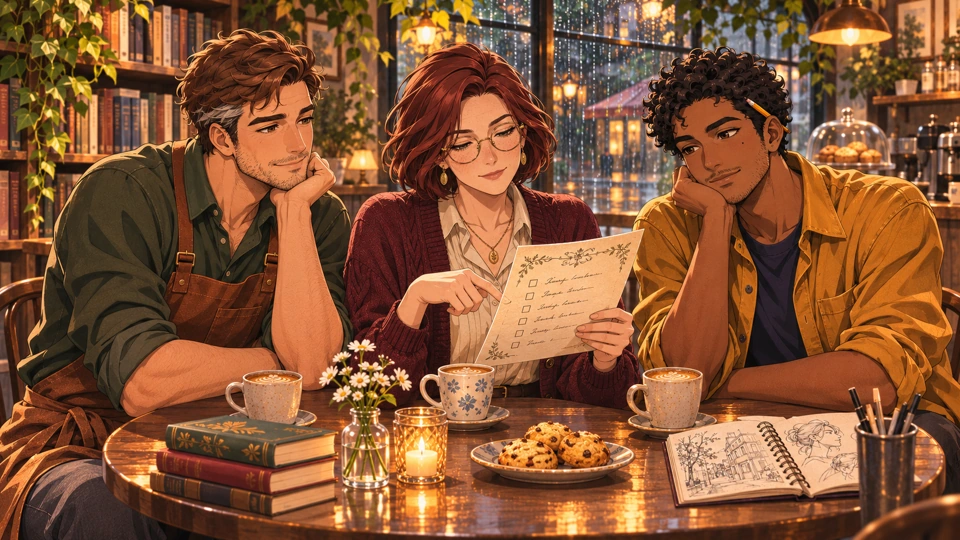
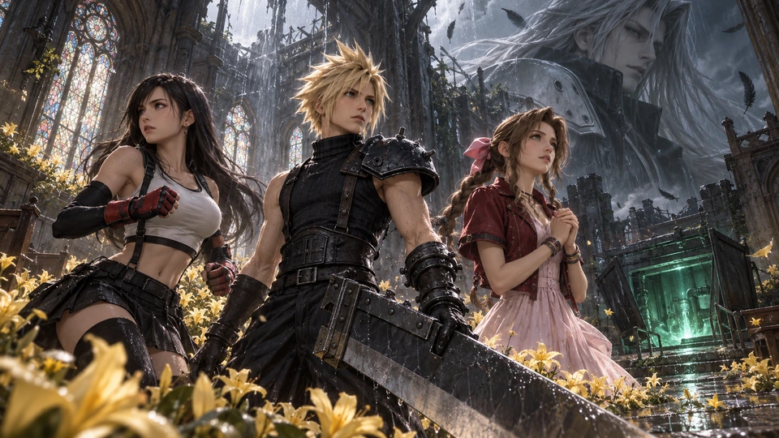
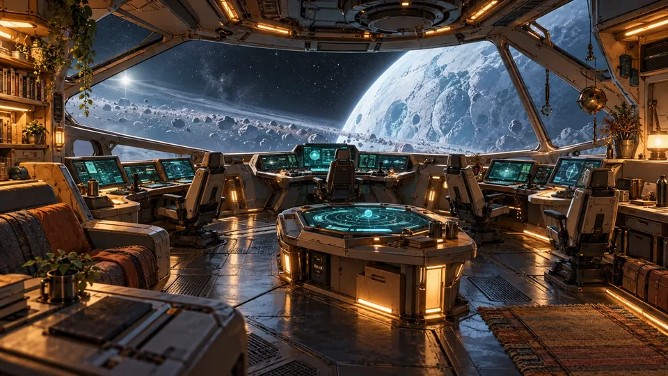

<p align="center">
  
</p>

# OtakuSoul Content Library

Characters to talk to, stories to step into, and worlds to explore in [OtakuSoul](https://github.com/SnowwhiteOakheart/OtakuSoul). This repository supplies the app's Hub with ready-to-install character cards, Soul Stage stories, lorebooks, artwork and avatar resources.

**93 characters · 80 stories · 46 lorebooks · 23 collections**

[Get started](#get-started) · [Stories and characters](#stories-and-characters) · [Avatars and motions](#avatars-and-motions) · [Licenses and credits](#licenses-and-credits) · [Contributing](#contributing)

<p align="center">
  
  
  
</p>

## What's included

- **Character cards:** Character Card V2 profiles with personalities, opening messages, dialogue examples and expression portraits. Importable PNG cards contain their profile data; editable JSON copies live in the corresponding preset folders.
- **Soul Stages:** Interactive stories spanning fantasy, science fiction, mystery, comedy, everyday life, romance and atmospheric horror. Scenes define their cast, setting, opening and guidance for the AI narrator.
- **Lorebooks:** World knowledge, character relationships, clues and scenario rules that supply context during play.
- **Artwork and audio settings:** Character portraits, backgrounds and collection covers, plus voice descriptions and music prompts. Portrait sets vary by character; the supported six base expressions can be extended to fifteen slots.
- **Avatar resources:** VRM and Live2D entries, Inochi2D puppets, VRMA motion packs and talking-portrait model notices, with their own sources and terms.
- **Languages:** Character and story content is maintained in English, German, Russian and Japanese. App-interface translations are provided separately through `locales/ui/`. This README is maintained in English.

This is the content repository. The app, installation instructions and application source code are in [OtakuSoul](https://github.com/SnowwhiteOakheart/OtakuSoul).

## Get started

1. Open the **Hub** in OtakuSoul and refresh its catalog.
2. Choose a collection and select **Install all** to install its linked characters, stories and lorebooks.
3. Open an installed story in Soul Stage, or start a conversation with an installed character.

For individual imports, download the original PNG from [`cards_gateway/`](cards_gateway/) or a story JSON from [`stages_gateway/`](stages_gateway/). A story may require additional character cards and lorebooks; installing its Hub collection brings these together. Keep PNG cards as original files so their embedded profile data is preserved.

Hub downloads require an internet connection. After downloading the app's required models and content, local-model conversations and stories can run offline. Online model services remain optional.

## Stories and characters

The catalog below covers every registered story and character. Character names link to importable PNG cards; story titles link to scene definitions. Times are approximate and depend on the conversation. Crossover collections reuse characters from other settings, so a character can appear in more than one collection.

### Collections at a glance

| Collection | Stories | Characters | Setting |
|---|---:|---:|---|
| [Sakura Succubus 3](#collection-sakura-succubus-3) | 9 | 6 | Tokyo comedy, friendship and romance |
| [No Game No Life](#collection-no-game-no-life) | 12 | 7 | Fantasy games and strategic challenges |
| [Dungeon Meshi](#collection-dungeon-meshi) | 5 | 4 | Dungeon exploration and monster cuisine |
| [Steins;Gate](#collection-steins-gate) | 5 | 4 | Time travel and world-line mysteries |
| [Lycoris Recoil](#collection-lycoris-recoil) | 4 | 4 | Café life and covert action |
| [Sword Art Online](#collection-sword-art-online) | 5 | 4 | Aincrad adventures |
| [Night City 2077](#collection-night-city-2077) | 2 | 4 | Cyberpunk crossover missions |
| [Aetheria Chronicles](#collection-aetheria-chronicles) | 2 | 4 | Fantasy crossover adventures |
| [Heartbeats & Cherry Blossoms](#collection-herzensklopfen) | 2 | 6 | School-romance crossovers |
| [The Quintessential Quintuplets](#collection-quintessential-quintuplets) | 5 | 6 | Tutoring, school life and romance |
| [Sternenbruch](#collection-sternenbruch) | 7 | 6 | Original science fiction and crew life |
| [World of Warcraft – Tirisfal](#collection-world-of-warcraft-tirisfal) | 1 | 5 | An original fan cast in Azeroth |
| [Re:Zero – Starting Life in Another World](#collection-re-zero) | 2 | 6 | Lugnica, magic and mysterious threats |
| [Overlord – The Great Tomb of Nazarick](#collection-overlord) | 1 | 3 | Dark fantasy and Nazarick |
| [NTE: Neverness to Everness](#collection-neverness-to-everness) | 1 | 8 | Urban fantasy and anomalies |
| [SPY×FAMILY – Operation Picnic](#collection-spy-x-family) | 1 | 3 | Family comedy and a parcel mystery |
| [Final Fantasy VII – The Echo Beneath Midgar](#collection-final-fantasy-vii) | 2 | 4 | Midgar mystery and a quiet visit with Tifa |
| [Studio 39 – Tracks and Performances](#collection-studio-39-vier-takte-vor-mitternacht) | 5 | 3 | Studio mystery and collaborative music-making |
| [Café Between Days](#collection-cafe-zwischen-den-tagen) | 3 | 3 | Original neighborhood life and optional romance |
| [Riverside Encounters](#collection-begegnungen-am-fluss) | 3 | 3 | Original adult friendship and optional romance |
| [Lost Property for Impossible Things](#collection-fundbuero-unmoeglicher-dinge) | 1 | 3 | Original supernatural detective fiction |
| [Night Shift on Platform 0](#collection-gleis-null) | 1 | 3 | Original atmospheric railway horror |
| [Aobane – Small Moments](#collection-aobane-kleine-momente) | 1 | 2 | Original school life and photography |

### Full story catalog

Expand a collection to see its cast and every included story.

<a id="collection-sakura-succubus-3"></a>

<details>
<summary><strong>Sakura Succubus 3</strong> — 9 stories</summary>

Succubi in Tokyo, an overcrowded shared flat and a secret that must not make the papers.

**Characters:** [Cosmos](cards_gateway/Cosmos.png), [Ayu Ikue](cards_gateway/Ayu_Ikue.png), [Marina Wakatsuki](cards_gateway/Marina_Wakatsuki.png), [Hazel Williams](cards_gateway/Hazel_Williams.png), [Hifumi Yamamoto](cards_gateway/Hifumi_Yamamoto.png), [Yue](cards_gateway/Yue.png).

**Stories:**

- [Editorial Deadline](stages_gateway/redaktionsschluss.json) — about 30 minutes.
- [The Charity Ball](stages_gateway/der_wohltaetigkeitsball.json) — about 45 minutes.
- [Apartment War](stages_gateway/wohnungskrieg.json) — about 30 minutes.
- [Audience in the Throne Room](stages_gateway/audienz_im_thronsaal.json) — about 45 minutes.
- [Tea for Two](stages_gateway/ein_tee_zu_zweit.json) — about 30 minutes.
- [Match Point](stages_gateway/matchball.json) — about 30 minutes.
- [Hanami Live at Ueno Park](stages_gateway/hanami_live_ayu_cosmos.json) — about 30 minutes.
- [The Missing Microphone](stages_gateway/missing_mic_ayu_cosmos.json) — about 45 minutes.
- [A Night at Ryokan Tsukimi](stages_gateway/ryokan_night_ayu_cosmos.json) — about 45 minutes.

[Browse package assets](presets/sakura-succubus-3/).

</details>

<a id="collection-no-game-no-life"></a>

<details>
<summary><strong>No Game No Life</strong> — 12 stories</summary>

Disboard, where every conflict is settled by a game: Sora and Shiro challenge the sixteen races.

**Characters:** [Sora](cards_gateway/Sora.png), [Shiro](cards_gateway/Shiro.png), [Stephanie Dola](cards_gateway/Stephanie_Dola.png), [Jibril](cards_gateway/Jibril.png), [Chlammy Zell](cards_gateway/Chlammy_Zell.png), [Fiel Nirvalen](cards_gateway/Fiel_Nirvalen.png), [Izuna Hatsuse](cards_gateway/Izuna_Hatsuse.png).

**Stories:**

- [Chapter 1: Beginner](stages_gateway/episode1_anfaenger.json) — about 30 minutes.
- [Chapter 2: Challenger](stages_gateway/episode2_herausforderer.json) — about 30 minutes.
- [Chapter 3: Expert](stages_gateway/episode3_experte.json) — about 45 minutes.
- [Chapter 4: Grandmaster](stages_gateway/episode4_grossmeister.json) — about 45 minutes.
- [Chapter 5: Weak Field](stages_gateway/episode5_schwaches_feld.json) — about 30 minutes.
- [Chapter 6: Interesting - The Duel against Jibril](stages_gateway/episode6_interessant_jibril.json) — about 45 minutes.
- [Chapter 7: Sacrifice](stages_gateway/episode7_opfer.json) — about 45 minutes.
- [Chapter 8: False End](stages_gateway/episode8_falsches_ende.json) — about 45 minutes.
- [Chapter 9: Sky Walk](stages_gateway/episode9_himmelswandel.json) — about 45 minutes.
- [Chapter 10: Blue Rose](stages_gateway/episode10_blaue_rose.json) — about 45 minutes.
- [Chapter 11: Giant Killing](stages_gateway/episode11_riesentoeten.json) — about 45 minutes.
- [Chapter 12: Rule Number Ten](stages_gateway/episode12_regel_nummer_zehn.json) — about 45 minutes.

[Browse package assets](presets/no-game-no-life/).

</details>

<a id="collection-dungeon-meshi"></a>

<details>
<summary><strong>Dungeon Meshi</strong> — 5 stories</summary>

Deeper into the dungeon to save Falin – cooking whatever the monsters have to offer along the way.

**Characters:** [Laios Touden](cards_gateway/laios_touden.png), [Marcille Donato](cards_gateway/marcille_donato.png), [Chilchuck Tims](cards_gateway/chilchuck_tims.png), [Senshi](cards_gateway/senshi.png).

**Stories:**

- [Dungeon Meshi – Episode 1: Scorpion Soup & Walking Mushrooms](stages_gateway/dungeon_meshi_ep1_skorpionsuppe.json) — about 30 minutes.
- [Dungeon Meshi – Episode 2: The Blade-Tail Basilisk](stages_gateway/dungeon_meshi_ep2_klingenbasilisk.json) — about 45 minutes.
- [Dungeon Meshi – Episode 3: Mandrake Harvest](stages_gateway/dungeon_meshi_ep3_alraunenernte.json) — about 30 minutes.
- [Dungeon Meshi – Episode 4: The Undines of the Deep](stages_gateway/dungeon_meshi_ep4_wassergeister.json) — about 45 minutes.
- [Dungeon Meshi – Episode 5: The Red Dragon](stages_gateway/dungeon_meshi_ep5_roter_drache.json) — about 60 minutes.

[Browse package assets](presets/dungeon-meshi/).

</details>

<a id="collection-steins-gate"></a>

<details>
<summary><strong>Steins;Gate</strong> — 5 stories</summary>

Akihabara 2010: a microwave sends messages into the past, and each one shifts the world line.

**Characters:** [Okabe Rintarou](cards_gateway/okabe_rintarou.png), [Mayuri Shiina](cards_gateway/mayuri_shiina.png), [Itaru Hashida](cards_gateway/itaru_hashida.png), [Suzuha Amane](cards_gateway/suzuha_amane.png).

**Stories:**

- [Steins;Gate – Episode 1: The First D-Mail](stages_gateway/steins_gate_ep1_erste_dmail.json) — about 45 minutes.
- [Steins;Gate – Episode 2: Hunt for the IBN 5100](stages_gateway/steins_gate_ep2_ibn5100_suche.json) — about 30 minutes.
- [Steins;Gate – Episode 3: Operation Urd](stages_gateway/steins_gate_ep3_operation_urd.json) — about 45 minutes.
- [Steins;Gate – Episode 4: The Butterfly Effect](stages_gateway/steins_gate_ep4_schmetterlingseffekt.json) — about 45 minutes.
- [Steins;Gate – Episode 5: The Gate to Steins Gate](stages_gateway/steins_gate_ep5_tor_zu_steins_gate.json) — about 45 minutes.

[Browse package assets](presets/steins-gate/).

</details>

<a id="collection-lycoris-recoil"></a>

<details>
<summary><strong>Lycoris Recoil</strong> — 4 stories</summary>

Café LycoReco: coffee at the counter, DA missions in the back room.

**Characters:** [Chisato Nishikigi](cards_gateway/chisato_nishikigi.png), [Takina Inoue](cards_gateway/takina_inoue.png), [Kurumi](cards_gateway/kurumi.png), [Mizuki Nakahara](cards_gateway/mizuki_nakahara.png).

**Stories:**

- [Lycoris Recoil – Episode 1: Welcome to Café LycoReco](stages_gateway/lycoris_recoil_ep1_willkommen_im_cafe.json) — about 30 minutes.
- [Lycoris Recoil – Episode 2: Escort Through Tokyo](stages_gateway/lycoris_recoil_ep2_geleitschutz_tokio.json) — about 45 minutes.
- [Lycoris Recoil – Episode 3: The Hunt for Walnut](stages_gateway/lycoris_recoil_ep3_jagd_nach_walnut.json) — about 45 minutes.
- [Lycoris Recoil – Episode 4: Duel at Dawn](stages_gateway/lycoris_recoil_ep4_duell_im_morgengrauen.json) — about 45 minutes.

[Browse package assets](presets/lycoris-recoil/).

</details>

<a id="collection-sword-art-online"></a>

<details>
<summary><strong>Sword Art Online</strong> — 5 stories</summary>

Trapped in Aincrad: a hundred floors, no logout, and dying in the game means dying for real.

**Characters:** [Kirito (Kazuto Kirigaya)](cards_gateway/kirito_kazuto.png), [Klein (Ryoutarou Tsuboi)](cards_gateway/klein_ryoutarou.png), [Asuna Yuuki](cards_gateway/asuna_yuuki.png), [Lisbeth (Rika Shinozaki)](cards_gateway/lisbeth_rika.png).

**Stories:**

- [Sword Art Online – Episode 1: The Proclamation](stages_gateway/sao_ep1_die_verkuendung.json) — about 45 minutes.
- [Sword Art Online – Episode 2: Overlord of the First Floor](stages_gateway/sao_ep2_boss_ebene1.json) — about 45 minutes.
- [Sword Art Online – Episode 3: Warmth of the Heart](stages_gateway/sao_ep3_waerme_des_herzens.json) — about 45 minutes.
- [Sword Art Online – Episode 4: Duel in the Shadows](stages_gateway/sao_ep4_duell_in_den_schatten.json) — about 45 minutes.
- [Sword Art Online – Episode 5: The Gleam Eyes](stages_gateway/sao_ep5_der_glaenzende_blick.json) — about 45 minutes.

[Browse package assets](presets/sword-art-online/).

</details>

<a id="collection-night-city-2077"></a>

<details>
<summary><strong>Night City 2077</strong> — 2 stories</summary>

Neon, corporations and the Net: jobs for edgerunners in the shadow of Night City.

**Characters:** [Kurumi](cards_gateway/kurumi.png), [Shinku](cards_gateway/shinku.png), [Lacrimosa](cards_gateway/lacrimosa.png), [Chisato Nishikigi](cards_gateway/chisato_nishikigi.png).

**Stories:**

- [Night City 2077: Ghost in the Subgrid](stages_gateway/cyberpunk_ghost_in_subgrid.json) — about 45 minutes.
- [Night City 2077: Cold Deal at the Afterlife](stages_gateway/cyberpunk_afterlife_deal.json) — about 45 minutes.

[Browse package assets](presets/cyberpunk-night-city/).

</details>

<a id="collection-aetheria-chronicles"></a>

<details>
<summary><strong>Aetheria Chronicles</strong> — 2 stories</summary>

Summoned into a fantasy world of guilds, system magic and a labyrinth full of stars.

**Characters:** [Frieren](cards_gateway/Frieren.png), [Megumin](cards_gateway/megumin.png), [Rem](cards_gateway/rem.png), [Marcille Donato](cards_gateway/marcille_donato.png).

**Stories:**

- [Isekai Chronicles: Summoned at Level Zero](stages_gateway/isekai_null_mana_summoning.json) — about 45 minutes.
- [Isekai Chronicles: The Forbidden Dungeon Core](stages_gateway/isekai_labyrinth_of_aetheria.json) — about 45 minutes.

[Browse package assets](presets/isekai-aetheria/).

</details>

<a id="collection-herzensklopfen"></a>

<details>
<summary><strong>Heartbeats & Cherry Blossoms</strong> — 2 stories</summary>

Rain in the club room, fireworks on the roof: anime romance at the academy.

**Characters:** [Marin Kitagawa](cards_gateway/Marin_Kitagawa.png), [Hayase Nagatoro](cards_gateway/Hayase_Nagatoro.png), [Aoi Mizuno](cards_gateway/Aoi_Mizuno.png), [Kaguya Shinomiya](cards_gateway/kaguya_shinomiya.png), [Asuna Yuuki](cards_gateway/asuna_yuuki.png), [Rem](cards_gateway/rem.png).

**Stories:**

- [After-School Heartbeats: One Umbrella for Four](stages_gateway/romance_rainy_clubroom_confessions.json) — about 30 minutes.
- [Cultural Festival Legend: Who Gets the Last Dance?](stages_gateway/romance_rooftop_festival_fireworks.json) — about 45 minutes.

[Browse package assets](presets/anime-academy-romance/).

</details>

<a id="collection-quintessential-quintuplets"></a>

<details>
<summary><strong>The Quintessential Quintuplets</strong> — 5 stories</summary>

Five sisters, one tutor and the question of which of them will be the bride in the end.

**Characters:** [Futaro Uesugi](cards_gateway/Futaro_Uesugi.png), [Ichika Nakano](cards_gateway/Ichika_Nakano.png), [Nino Nakano](cards_gateway/Nino_Nakano.png), [Miku Nakano](cards_gateway/Miku_Nakano.png), [Yotsuba Nakano](cards_gateway/Yotsuba_Nakano.png), [Itsuki Nakano](cards_gateway/Itsuki_Nakano.png).

**Stories:**

- [The Quintessential Quintuplets – Episode 1: Penthouse Tutoring](stages_gateway/quintuplets_ep1_penthouse_nachhilfe.json) — about 40 minutes.
- [The Quintessential Quintuplets – Episode 2: Summer Fireworks](stages_gateway/quintuplets_ep2_feuerwerk_gestaendnis.json) — about 35 minutes.
- [The Quintessential Quintuplets – Episode 3: Trial by Midterms](stages_gateway/quintuplets_ep3_zwischenpruefung.json) — about 45 minutes.
- [The Quintessential Quintuplets – Episode 4: Snowbound Cabin](stages_gateway/quintuplets_ep4_schneefahrt_huette.json) — about 45 minutes.
- [The Quintessential Quintuplets – Episode 5: School Festival of Memories](stages_gateway/quintuplets_ep5_schulfest_gestaendnisse.json) — about 50 minutes.

[Browse package assets](presets/quintessential-quintuplets/).

</details>

<a id="collection-sternenbruch"></a>

<details>
<summary><strong>Sternenbruch</strong> — 7 stories</summary>

A signal at the edge of the map, a small crew and a gate that should have stayed shut.

**Characters:** [Mara Venn](cards_gateway/sternenbruch_mara_venn.png), [Juno Serrat](cards_gateway/sternenbruch_juno_serrat.png), [IVO](cards_gateway/sternenbruch_ivo.png), [Saeli](cards_gateway/sternenbruch_saeli.png), [Kian Rook](cards_gateway/sternenbruch_kian_rook.png), [Dr. Idris Vale](cards_gateway/sternenbruch_idris_vale.png).

**Stories:**

- [Sternenbruch – 1: A signal from tomorrow](stages_gateway/sternenbruch_ep1_signal.json) — about 45 minutes.
- [Sternenbruch – 2: Market under alien stars](stages_gateway/sternenbruch_ep2_market.json) — about 45 minutes.
- [Sternenbruch – 3: The ship without shadows](stages_gateway/sternenbruch_ep3_nacre.json) — about 45 minutes.
- [Sternenbruch – 4: The garden in the ice](stages_gateway/sternenbruch_ep4_garden.json) — about 45 minutes.
- [Sternenbruch – 5: Who owns a memory?](stages_gateway/sternenbruch_ep5_memory.json) — about 45 minutes.
- [Sternenbruch – 6: The last connection](stages_gateway/sternenbruch_ep6_gate.json) — about 60 minutes.
- [A Station for the Journey Home](stages_gateway/sternenbruch_kurz_radio.json) — about 15 minutes.

[Browse package assets](presets/sternenbruch/).

</details>

<a id="collection-world-of-warcraft-tirisfal"></a>

<details>
<summary><strong>World of Warcraft – Tirisfal</strong> — 1 story</summary>

Five companions, a funeral bell and stolen memories: an original post-Mists of Pandaria fan adventure with 75 expressions.

**Characters:** [Liora Sonnenfaden](cards_gateway/liora_sonnenfaden.png), [Vaelis Morgenpfad](cards_gateway/vaelis_morgenpfad.png), [Bo Wolkenkrug](cards_gateway/bo_wolkenkrug.png), [Gromak Aschenfaust](cards_gateway/gromak_aschenfaust.png), [Mira Dämmerfrost](cards_gateway/mira_daemmerfrost.png).

**Stories:**

- [The Bell of Nameless Souls](stages_gateway/wow_glocke_der_namenlosen_seelen.json) — about 90 minutes.

[Browse package assets](presets/world-of-warcraft/).

</details>

<a id="collection-re-zero"></a>

<details>
<summary><strong>Re:Zero – Starting Life in Another World</strong> — 2 stories</summary>

The Dragon Kingdom of Lugnica, Roswaal Manor, and the deadly taboo of the Witch: Subaru, Emilia, Beatrice, Ram, and Echidna caught between fate loops and arcane mysteries.

**Characters:** [Emilia](cards_gateway/emilia.png), [Subaru Natsuki](cards_gateway/subaru_natsuki.png), [Rem](cards_gateway/rem.png), [Ram](cards_gateway/ram.png), [Beatrice](cards_gateway/beatrice.png), [Echidna](cards_gateway/echidna.png).

**Stories:**

- [Shadows Over Roswaal Manor](stages_gateway/re_zero_ep1_schatten_ueber_dem_anwesen.json) — about 50 minutes.
- [The Bells of Frostweiler](stages_gateway/frozen_bells_emilia.json) — about 45 minutes.

[Browse package assets](presets/re-zero/).

</details>

<a id="collection-overlord"></a>

<details>
<summary><strong>Overlord – The Great Tomb of Nazarick</strong> — 1 story</summary>

Ainz Ooal Gown, Albedo, and Shalltear before the Throne of Kings: The impregnable fortress of Nazarick sets out to conquer the New World.

**Characters:** [Ainz Ooal Gown](cards_gateway/ainz_ooal_gown.png), [Albedo](cards_gateway/albedo.png), [Shalltear Bloodfallen](cards_gateway/shalltear_bloodfallen.png).

**Stories:**

- [Audience in the Throne Room of Nazarick](stages_gateway/overlord_ep1_audienz_in_nazarick.json) — about 50 minutes.

[Browse package assets](presets/overlord/).

</details>

<a id="collection-neverness-to-everness"></a>

<details>
<summary><strong>NTE: Neverness to Everness</strong> — 1 story</summary>

Urban anomalies, the Eibon Antique Shop, and the neon avenues of Hethereau: Nanally, Mint, Iroi, Linko, and Esper Zero confronting the Nexus.

**Characters:** [Mint](cards_gateway/mint.png), [Iroi](cards_gateway/iroi.png), [Lacrimosa](cards_gateway/lacrimosa.png), [Nanally Colucci](cards_gateway/nanally.png), [Linko](cards_gateway/linko.png), [Esper Zero (Female)](cards_gateway/zero_female.png), [Esper Zero (Male)](cards_gateway/zero_male.png), [Shinku](cards_gateway/shinku.png).

**Stories:**

- [The Mirror District Anomaly](stages_gateway/nte_ep1_die_anomalie_im_spiegelbezirk.json) — about 50 minutes.

[Browse package assets](presets/neverness-to-everness/).

</details>

<a id="collection-spy-x-family"></a>

<details>
<summary><strong>SPY×FAMILY – Operation Picnic</strong> — 1 story</summary>

Anya, Loid and Yor Forger: family comedy and a mysterious parcel mix-up in a museum garden. Three characters, two lorebooks and a story with cover.

**Characters:** [Anya Forger](cards_gateway/anya_forger.png), [Yor Forger](cards_gateway/yor_forger.png), [Loid Forger](cards_gateway/loid_forger.png).

**Stories:**

- [Operation Picnic – The Wrong Parcel](stages_gateway/spy_family_operation_picknick.json) — about 60 minutes.

[Browse package assets](presets/spy-x-family/).

</details>

<a id="collection-final-fantasy-vii"></a>

<details>
<summary><strong>Final Fantasy VII – The Echo Beneath Midgar</strong> — 2 stories</summary>

A forgotten Shinra archive awakens beneath Aerith’s church. With Tifa, Aerith and Cloud, rescue missing workers and test memories while Sephiroth offers a dangerous bargain.

**Characters:** [Tifa Lockhart](cards_gateway/tifa_lockhart.png), [Aerith Gainsborough](cards_gateway/aerith_gainsborough.png), [Cloud Strife](cards_gateway/cloud_strife.png), [Sephiroth](cards_gateway/sephiroth.png).

**Stories:**

- [The Echo Beneath Midgar](stages_gateway/ff7_das_echo_unter_midgar.json) — about 90 minutes.
- [After Closing at Seventh Heaven](stages_gateway/ff7_kurz_nach_ladenschluss.json) — about 15 minutes.

[Browse package assets](presets/final-fantasy-vii/).

</details>

<a id="collection-studio-39-vier-takte-vor-mitternacht"></a>

<details>
<summary><strong>Studio 39 – Tracks and Performances</strong> — 5 stories</summary>

A late-night studio mystery, a short sound-based chorus and three creative episodes leading to a small dress rehearsal with Miku, Rin and Luka.

**Characters:** [Hatsune Miku](cards_gateway/hatsune_miku.png), [Kagamine Rin](cards_gateway/kagamine_rin.png), [Megurine Luka](cards_gateway/megurine_luka.png).

**Stories:**

- [Four Bars to Midnight](stages_gateway/studio_39_vier_takte_vor_mitternacht.json) — about 35 minutes.
- [Three Sounds, One Chorus](stages_gateway/studio_39_kurz_drei_geraeusche.json) — about 10 minutes.
- [Our First Performance – 1: What We Sing About](stages_gateway/studio_39_auftritt_ep1_refrain.json) — about 20 minutes.
- [Our First Performance – 2: Light and Breath](stages_gateway/studio_39_auftritt_ep2_buehnenplan.json) — about 20 minutes.
- [Our First Performance – 3: The Small Dress Rehearsal](stages_gateway/studio_39_auftritt_ep3_generalprobe.json) — about 25 minutes.

[Browse package assets](presets/studio-39/).

</details>

<a id="collection-cafe-zwischen-den-tagen"></a>

<details>
<summary><strong>Café Between Days</strong> — 3 stories</summary>

Three adult neighbors, a familiar place and three small stories: find a seat, trace a cake order and host a first reading. Friendship or optional slow romance.

**Characters:** [Jonas Berg](cards_gateway/jonas_berg.png), [Mira Falk](cards_gateway/mira_falk.png), [Leo Winter](cards_gateway/leo_winter.png).

**Stories:**

- [Your Usual Table Is Taken](stages_gateway/cafe_ep1_fenstertisch.json) — about 20 minutes.
- [A Cake for Someone Who Does Not Come](stages_gateway/cafe_ep2_kuchen.json) — about 20 minutes.
- [The First Reading](stages_gateway/cafe_ep3_erste_lesung.json) — about 25 minutes.

[Browse package assets](presets/cafe-zwischen-den-tagen/).

</details>

<a id="collection-begegnungen-am-fluss"></a>

<details>
<summary><strong>Riverside Encounters</strong> — 3 stories</summary>

Meet Elias, Noah and Sami in three independent stories: a workshop, a final radio show and a night garden. Adult characters, open player identity, friendship or mutual romance.

**Characters:** [Elias Hartmann](cards_gateway/elias_hartmann.png), [Noah Sommer](cards_gateway/noah_sommer.png), [Sami Rahman](cards_gateway/sami_rahman.png).

**Stories:**

- [What May Remain](stages_gateway/begegnungen_ep1_reparaturspuren.json) — about 25 minutes.
- [The Last Broadcast](stages_gateway/begegnungen_ep2_letzte_sendung.json) — about 25 minutes.
- [A Garden After Sunset](stages_gateway/begegnungen_ep3_nachtgarten.json) — about 25 minutes.

[Browse package assets](presets/begegnungen-am-fluss/).

</details>

<a id="collection-fundbuero-unmoeglicher-dinge"></a>

<details>
<summary><strong>Lost Property for Impossible Things</strong> — 1 story</summary>

Vera, Oskar and Nia investigate an umbrella that rains inside. A standalone first detective case with fixed clues, a testable anomaly and three paths to resolution.

**Characters:** [Vera Lenz](cards_gateway/vera_lenz.png), [Oskar Reed](cards_gateway/oskar_reed.png), [Nia Quill](cards_gateway/nia_quill.png).

**Stories:**

- [Case 01: The Umbrella That Rains Inside](stages_gateway/fundbuero_fall01_innenregen.json) — about 35 minutes.

[Browse package assets](presets/fundbuero-unmoeglicher-dinge/).

</details>

<a id="collection-gleis-null"></a>

<details>
<summary><strong>Night Shift on Platform 0</strong> — 1 story</summary>

At 00:17 an unplugged phone rings. Join Ada, Ben and Ruth for a first night shift: atmospheric horror with testable rules and safe retreat, without gore.

**Characters:** [Ada Kern](cards_gateway/ada_kern.png), [Ben Ortiz](cards_gateway/ben_ortiz.png), [Ruth Seidel](cards_gateway/ruth_seidel.png).

**Stories:**

- [Night Shift on Platform 0 – 00:17](stages_gateway/gleis_null_ep1_0017.json) — about 20 minutes.

[Browse package assets](presets/gleis-null/).

</details>

<a id="collection-aobane-kleine-momente"></a>

<details>
<summary><strong>Aobane – Small Moments</strong> — 1 story</summary>

Fifteen minutes with Ren and Aoi in photography club: two harbor pictures, one empty exhibition spot and your shared caption.

**Characters:** [Ren Takahashi](cards_gateway/Ren_Takahashi.png), [Aoi Mizuno](cards_gateway/Aoi_Mizuno.png).

**Stories:**

- [The Last Photo for the Exhibition](stages_gateway/aobane_kurz_letztes_foto.json) — about 15 minutes.

[Browse package assets](presets/aobane-highschool/).

</details>

### Standalone characters

These cards are available for conversation without a dedicated story collection.

| Character | Origin |
|---|---|
| [Lucy](cards_gateway/Lucy.png) | Elfen Lied; Lucy / Nyu character profile |

## Avatars and motions

The Hub also lists **11 VRM/Live2D avatar entries**, **3 Inochi2D puppets** and a **Quaternius starter pack with 8 motions**: idle, talking, walking, sitting, jumping, falling, landing and dancing. Some entries download files; others link to a creator's model page. Availability in the Hub does not give every asset the same license.

- [VRM and Live2D catalog](avatars_registry.json)
- [Inochi2D puppet catalog](inochi2d_registry.json)
- [Motion-pack catalog](motion_packs_registry.json)
- [Talking-portrait models and conversion notices](avatars/talking_portrait/lizenzen.txt)

## Licenses and credits

### Repository contributions and exceptions

The repository's [LICENSE](LICENSE) specifies **GNU GPL v3.0 only (`GPL-3.0-only`)** for original scripts, documentation, texts, translations, configurations and other original contributions, to the extent their contributors hold the necessary rights. Its AI-artwork provisions apply on that same basis. This is an independent, non-commercial fan project; it is not an official product of the franchises represented here.

**That license does not grant rights to third-party characters, worlds, trademarks or separately licensed assets.** Specific asset notices remain applicable. AI-generated artwork is documented as such; it does not remove underlying character rights or imply that every generated image has exclusive copyright protection. Keep authorship, source, generation and modification notices with redistributed material.

| Material | License or applicable terms | Source and attribution |
|---|---|---|
| Original repository contributions | GPL-3.0-only, within the scope described above | SnowwhiteOakheart; [full repository license](LICENSE) |
| Hatsune Miku, Kagamine Rin and Megurine Luka character adaptations | Character-specific non-commercial terms; the official character illustrations are offered under CC BY-NC 3.0 | Crypton Future Media, Inc.; [Piapro creator guidelines](https://piapro.net/intl/en_for_creators.html), [Studio 39 notices](presets/studio-39/README.md) |
| Seed-san VRM sample | CC0 1.0 | VRM Consortium / pixiv Inc.; [upstream sample](https://github.com/vrm-c/vrm-specification/tree/master/samples/Seed-san), [catalog entry](avatars_registry.json) |
| Niziiro Mao (PRO) and Shizuku (PRO) | Live2D Free Material License Agreement and sample-specific terms; not relicensed under GPL | Live2D Inc.; [license agreement](https://www.live2d.com/eula/live2d-free-material-license-agreement_en.html), [local notices](avatars/live2d/lizenzen.txt), [Mao readme](avatars/live2d/mao_pro/ReadMe.txt), [Shizuku readme](avatars/live2d/shizuku/ReadMe.txt) |
| Aka and Midori Inochi2D models | CC BY 4.0 | seagetch; [puppet catalog and source URLs](inochi2d_registry.json) |
| Hayase Nagatoro Inochi2D fan puppet | CC BY-NC 4.0 for original contributions; underlying character rights excluded | SnowwhiteOakheart, AI-assisted artwork and rigging; [asset-specific license](https://github.com/SnowwhiteOakheart/otakusoul-data/releases/download/nagatoro-inochi2d-v14/NAGATORO-LICENSE.md) |
| Quaternius Universal Animation Library motions | CC0 1.0 | Quaternius; [upstream library](https://quaternius.itch.io/universal-animation-library), [attribution and VRMA conversion notes](avatars/motions/lizenzen.txt) |
| Talking Head Anime 3 model / ONNX conversion | CC BY 4.0 for model weights; upstream demo code is MIT | Pramook Khungurn; [source project](https://github.com/pkhungurn/talking-head-anime-3-demo), [attribution, conversion and release details](avatars/talking_portrait/lizenzen.txt) |
| anime-seg ISNet model | Apache-2.0, as recorded in the model notice | skytnt; [source model](https://huggingface.co/skytnt/anime-seg), [local notice](avatars/talking_portrait/lizenzen.txt) |
| Recommended language models | Per-model terms, separate from this repository; weights are not included | [Desktop catalog](recommended_models.json), [mobile catalog](recommended_models_mobile.json); consult each linked model card |
| Optional 5e rule references | The app's SRD 5.1 material is attributed under CC BY 4.0 | Wizards of the Coast LLC; see [repository notices](LICENSE) and the [app's SRD data](https://github.com/SnowwhiteOakheart/OtakuSoul/tree/main/presets/srd5) |

The model catalog explicitly records **Rocinante-X 12B** and **Cydonia 24B v4.3** with an **unknown license**. Their base-model licenses are not presented as permission for the fine-tuned releases. Check each model's own terms before using or redistributing its weights.

Piapro character credits: **Hatsune Miku** and **Kagamine Rin**, © Crypton Future Media, Inc. 2007; **Megurine Luka**, © Crypton Future Media, Inc. 2009. Based on works at [piapro.net/license](https://piapro.net/license), with [CC BY-NC 3.0](https://creativecommons.org/licenses/by-nc/3.0/) notices. The official illustration license does not automatically cover music, voice recordings or other creators' artwork.

### VRoid Hub models

These community VRM files are **not tracked in this Git repository**. Their Hub entries point to model pages; each creator's usage, credit, modification and redistribution terms apply. The table identifies the sources recorded in this repository; [the detailed notices](avatars/vrm/lizenzen.txt) retain the per-model conditions.

| Model | Creator / recorded attribution | Source |
|---|---|---|
| Yuri | Lala | [VRoid Hub model page](https://hub.vroid.com/en/characters/4336227932743836004/models/1700604965229935902) |
| Freemodel オーロラグラデJK | pinehead / © 2026 MercuryMaid | [VRoid Hub model page](https://hub.vroid.com/en/characters/6997111234814927135/models/6071722136745758338) |
| Angel Egna | KANA | [VRoid Hub model page](https://hub.vroid.com/en/characters/8559605736438220397/models/6856185847602907189) |
| Nyx Advent | Astral_Overseas | [VRoid Hub model page](https://hub.vroid.com/en/characters/1604943105772755711/models/6150833061750504767) |
| Mikku | Creator credit on the linked model page | [VRoid Hub model page](https://hub.vroid.com/en/characters/7032412562763742257/models/4025778039146486049) |
| 2B | RAMMSIOO (© 2024) | [VRoid Hub model page](https://hub.vroid.com/en/characters/7668160067984824906/models/2242061262413958110) |
| Hoshika | Creator credit on the linked model page | [VRoid Hub model page](https://hub.vroid.com/en/characters/3990471198787218878/models/3661778864028306547) |
| modelT2-bodyglove | hecote464748 | [VRoid Hub model page](https://hub.vroid.com/en/characters/6768471073562252128/models/2803042328906244342) |

### Franchise credits

The following creator, publisher and production credits identify the underlying works represented by the story and character catalog. They are not a grant of rights or an exhaustive ownership statement. OtakuSoul original characters and original settings remain identified as such in their package documentation.

| Work | Credits |
|---|---|
| Overlord | © Kugane Maruyama / so-bin / KADOKAWA / Overlord Animation Project |
| The Quintessential Quintuplets | © Negi Haruba / KODANSHA / Bibury Animation Studios |
| Dungeon Meshi | © Ryoko Kui / KADOKAWA / Studio TRIGGER |
| Steins;Gate | © MAGES. / 5pb. / Chiyomaru Studio / NITRO PLUS / White Fox |
| Lycoris Recoil | © Spider Lily / Asaura / Aniplex / A-1 Pictures |
| Sword Art Online | © Reki Kawahara / abec / ASCII Media Works / KADOKAWA / A-1 Pictures |
| No Game No Life | © Yuu Kamiya / KADOKAWA / Media Factory / MADHOUSE |
| Sakura Succubus | © Winged Cloud |
| Sousou no Frieren | © Kanehito Yamada, Tsukasa Abe / Shogakukan / Madhouse |
| My Dress-Up Darling | © Shinichi Fukuda / Square Enix / CloverWorks |
| Don't Toy With Me, Miss Nagatoro | © Nanashi / Kodansha / Telecom Animation Film |
| Spy x Family | © Tatsuya Endo / Shueisha / WIT STUDIO / CloverWorks |
| KonoSuba | © Natsume Akatsuki, Kurone Mishima / KADOKAWA / Studio Deen / Drive |
| Kaguya-sama: Love Is War | © Aka Akasaka / Shueisha / A-1 Pictures |
| Neverness to Everness | © Hotta Studio / Perfect World |
| Re:Zero | © Tappei Nagatsuki / KADOKAWA / Re:ZERO Animation Project |
| Cyberpunk 2077 | © CD PROJEKT S.A. / Mike Pondsmith, R. Talsorian Games |
| Elfen Lied | © Lynn Okamoto / Shueisha / VAP / Arms |
| Final Fantasy VII | Square Enix; [package provenance](presets/final-fantasy-vii/README.md) |
| World of Warcraft | Blizzard Entertainment; [package provenance](presets/world-of-warcraft/README.md) |
| Piapro Characters / Studio 39 | Crypton Future Media, Inc.; see the character-specific credits and terms above |

OtakuSoul builds on **Soul of Waifu** by **Jofi (`jofizcd`)**; see the [project credits and repository license](LICENSE). This credit does not replace the individual asset licenses above.

For a rights or attribution issue, [open an issue](https://github.com/SnowwhiteOakheart/otakusoul-data/issues) with the affected file path and supporting source information.

## Contributing

Contributions can add original characters, stories, lorebooks, artwork or app-interface translations. This repository accepts SFW content with age-appropriate character portrayals. Include accurate authorship, sources, generation prompts and applicable licenses; do not treat third-party character rights as your own to license.

**From the app:** use the character sharing action or a story's **Contribute to the hub** action. Attach the exported ZIP to the prefilled GitHub issue. The package carries its own license declaration; the submission checker accepts CC0-1.0, CC-BY-4.0 and CC-BY-SA-4.0. Automated checks are followed by maintainer review.

**Through a pull request:** follow [AI.md](AI.md) for card formats, translations, image sizes, registries and asset notices. Character and story contributions retain the four content languages even though this README is English-only. Validate the content before submitting:

```sh
python3 tools/validate_content.py --sync-registry
```

For app-interface translations, see [`locales/ui/`](locales/ui/) and [`locales/ui_registry.json`](locales/ui_registry.json); preserve placeholders and check against the app's translation keys.

## Repository map

| Path | Contents |
|---|---|
| [`soul_registry.json`](soul_registry.json) / [`cards_gateway/`](cards_gateway/) | Character catalog and importable PNG cards |
| [`stages_registry.json`](stages_registry.json) / [`stages_gateway/`](stages_gateway/) | Story catalog and scene definitions |
| [`lorebooks_registry.json`](lorebooks_registry.json) / [`lorebooks_gateway/`](lorebooks_gateway/) | Lorebook catalog and world/context entries |
| [`collections_registry.json`](collections_registry.json) | Collections linking characters, stories, lorebooks and covers |
| [`presets/`](presets/) | Package artwork, editable cards, prompt records and package documentation |
| [`avatars/`](avatars/) | Avatar and motion assets, provenance and asset-specific license notices |
| [`locales/`](locales/) | Story-system text and app-interface translations |
| [`recommended_models.json`](recommended_models.json) / [`recommended_models_mobile.json`](recommended_models_mobile.json) | Model metadata and download recommendations; no language-model weights |
| [`tools/`](tools/) | Content validation, submission and maintenance tools |
| [`CONTENT_INDEX.md`](CONTENT_INDEX.md) | Detailed content and app-integration reference |
| [`ROADMAP.md`](ROADMAP.md) | Development progress and planning |
| [`AI.md`](AI.md) | Repository authoring and validation rules |
| [`LICENSE`](LICENSE) | Repository license, scope, exceptions and notices |
